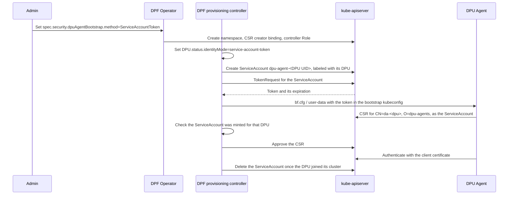

[[_TOC_]]

This guide explains how to let the DPU Agent obtain its first client certificate on clusters whose
kube-apiserver does not accept bootstrap tokens, by authenticating with a short-lived token of a
per-DPU ServiceAccount instead.

# Overview

The DPU Agent authenticates to the management-cluster kube-apiserver with a client certificate for
the user `da-<dpu-name>` in the group `dpu-agents`. To get its first certificate it needs another
credential, which DPF writes into a bootstrap kubeconfig in the OS configuration it installs the DPU
with: the bf.cfg of BlueField-3 DPUs, or the cloud-init user-data of BlueField-4 DPUs. With it, the DPU Agent creates a CertificateSigningRequest (CSR), which the
DPF provisioning controller approves. It then renews the certificate with the certificate itself.

By default that first credential is a per-DPU bootstrap token. Bootstrap tokens are only accepted
when the kube-apiserver runs with `--enable-bootstrap-token-auth`. kubeadm clusters do, but other
distributions do not: OpenShift does not support the flag, and managed Kubernetes services often
leave it off. Without the flag, the DPU Agent fails with
`cannot create certificate signing request: Unauthorized`.

The `ServiceAccountToken` bootstrap method replaces the bootstrap token with a short-lived token of
a per-DPU ServiceAccount, which does not depend on `--enable-bootstrap-token-auth`. Nothing else
changes: the bootstrap kubeconfig
is delivered the same way, the DPU Agent requests the same certificate, and once it has it, the DPU
Agent authenticates and renews exactly as with bootstrap tokens. The DPU Agent itself needs no
configuration, since it accepts any bearer token in its bootstrap kubeconfig.

The method is available in both Zero Trust and Host Trusted deployments. It covers the DPU Agent
only: the Host Agent of [hosts outside the Kubernetes cluster](host-installation-for-non-k8s-env/README.md)
still bootstraps with a bootstrap token of its own.

# How it works



In detail:

1. When a DPU is initialized, DPF sets its `status.identityMode` to `service-account-token`, and
   never changes it afterwards.
2. When DPF generates the DPU's bf.cfg or user-data, in the DPU phase `Prepare BFB`, it creates a
   ServiceAccount for the DPU in the configured namespace and requests a token for it with the
   TokenRequest API.
   * The ServiceAccount is named `dpu-agent-<DPU UID>`, because DPU names can be longer than a
     ServiceAccount name may be, and DPUs in different namespaces can share a name. Its labels,
     `provisioning.dpu.nvidia.com/dpu-name`, `provisioning.dpu.nvidia.com/dpu-namespace` and
     `provisioning.dpu.nvidia.com/dpu-uid`, map it back to its DPU.
   * The token is requested for 4 hours, like a bootstrap token, with the default audience of the
     kube-apiserver. A kube-apiserver running with `--service-account-max-token-expiration` may
     issue a shorter one.
3. The DPU Agent creates its CSR with the token. The kube-apiserver records the requester as
   `system:serviceaccount:<namespace>:dpu-agent-<DPU UID>`, with the UID of the ServiceAccount.
4. The DPF CSR approver only considers ServiceAccounts in the configured namespace. It approves the
   CSR when the ServiceAccount exists with that UID, its labels name an existing DPU with the
   matching UID, that DPU uses the `service-account-token` identity mode, and the CSR asks for the
   certificate of that DPU (`CN=da-<dpu-name>`, `O=dpu-agents`). Otherwise it leaves the CSR
   pending and logs why, as it does for any invalid DPU Agent CSR.
5. Once the DPU has joined its DPU cluster, DPF deletes the ServiceAccount, which revokes every
   token minted for it. It does the same when the DPU is deleted. Re-provisioning the DPU creates
   the ServiceAccount again.

# Configuration

Select the method in the `DPFOperatorConfig`:

```yaml
apiVersion: operator.dpu.nvidia.com/v1alpha1
kind: DPFOperatorConfig
metadata:
  name: dpfoperatorconfig
  namespace: dpf-operator-system
spec:
  security:
    dpuAgentBootstrap:
      method: ServiceAccountToken
      # Optional, this is the default.
      serviceAccountNamespace: dpf-dpu-agent-bootstrap
  # ...
```

| Field | Default | Description |
|-------|---------|-------------|
| `method` | `BootstrapToken` | `BootstrapToken` or `ServiceAccountToken`. |
| `serviceAccountNamespace` | `dpf-dpu-agent-bootstrap` | Namespace of the per-DPU ServiceAccounts. Only used by `ServiceAccountToken`. |

When the method is `ServiceAccountToken`, the DPF Operator creates:

* the namespace, labeled to enforce the `restricted` Pod Security Standard since nothing runs there;
* the ClusterRoleBinding `dpf-provisioning-dpu-agent-sa-bootstrap`, which grants the group
  `system:serviceaccounts:<namespace>` the right to create DPU Agent CSRs, as
  `dpf-provisioning-dpu-agent-bootstrap` does for the bootstrap token group;
* the Role and RoleBinding `dpf-provisioning-dpu-agent-sa-bootstrap` in that namespace, which let
  the provisioning controller manage the ServiceAccounts there and mint their tokens, and nowhere
  else.

## The namespace must be dedicated

The ClusterRoleBinding grants every ServiceAccount in the namespace the right to request DPU Agent
certificates, so the namespace must hold nothing but the ServiceAccounts DPF creates (and the
`default` ServiceAccount Kubernetes creates in every namespace): do not deploy workloads there, and
do not let anyone else create ServiceAccounts or tokens in it. Requesting a certificate is not
enough to get one, because the approver checks the ServiceAccount against its DPU, but only the
namespace keeps the right to request one to DPU Agents.

The API server rejects `default` and names starting with `kube-` or `openshift-`. Use a namespace
that does not exist yet: the operator creates it, and deletes it along with the
`DPFOperatorConfig`.

## Requirements

* The kube-apiserver must issue ServiceAccount tokens through the TokenRequest API, which every
  supported Kubernetes version does.
* The cluster must sign CSRs for the `kubernetes.io/kube-apiserver-client` signer, as
  kube-controller-manager does by default. This is a requirement of every bootstrap method, not of
  this one; some managed Kubernetes services do not sign them.

# Which DPUs are affected

The method is recorded on each DPU in `DPU.status.identityMode`. DPF sets it once, in the
`Initializing` phase, and never changes it afterwards:

| `status.identityMode` | The DPU Agent gets its first client certificate with |
|-----------------------|------------------------------------------------------|
| `bootstrap-token` | a bootstrap token. |
| `service-account-token` | a token of its bootstrap ServiceAccount. |
| `spiffe` | none: it authenticates with a SPIRE-issued JWT-SVID, see [SPIFFE Workload Identity](spiffe-identity.md). |
| unset | a bootstrap token (DPUs provisioned before identity modes existed). |

Selecting `ServiceAccountToken` therefore affects **newly initialized DPUs only**. DPUs that already
have the `bootstrap-token` mode keep using bootstrap tokens, also when they are re-provisioned, and a
cluster can hold a mix of both. To move an existing DPU to the new method, delete it and let it be
created again (by its DPUSet, for example). On a cluster without bootstrap token authentication,
select the method before the first DPU is created.

The method cannot be combined with `spec.security.spiffe`: SPIFFE-mode DPU Agents authenticate with
a JWT-SVID and never request a certificate with a token, so the API server rejects a configuration
that sets both.

# Changing the configuration

DPUs in the `service-account-token` mode mint a new token from the configuration every time they are
provisioned, and the CSR approver only trusts ServiceAccounts in the configured namespace. The API
server therefore rejects, once the method is `ServiceAccountToken`:

* changing the method back to `BootstrapToken`, or removing `dpuAgentBootstrap`;
* changing `serviceAccountNamespace`.

As for SPIFFE, the escape hatch is to delete and recreate the `DPFOperatorConfig`; existing
`service-account-token` DPUs then have to be re-provisioned.

While the method is `BootstrapToken`, `serviceAccountNamespace` can be changed freely.

# Verification

Check the identity mode of a DPU:

```shell
kubectl -n dpf-operator-system get dpu <dpu-name> -o jsonpath='{.status.identityMode}{"\n"}'
```

While a DPU is being provisioned, its bootstrap ServiceAccount exists:

```shell
kubectl -n dpf-dpu-agent-bootstrap get serviceaccounts -l provisioning.dpu.nvidia.com/dpu-name=<dpu-name>
```

When the DPU Agent boots, its CSR comes from that ServiceAccount and is approved with reason
`DPUAgentApproved`:

```shell
kubectl get csr -o custom-columns=NAME:.metadata.name,REQUESTOR:.spec.username,CONDITION:.status.conditions[*].reason
```

# Troubleshooting

**The DPU Agent logs `Unauthorized`.** The token is not accepted. Check that the DPU's identity mode
is `service-account-token` (a `bootstrap-token` DPU still gets a bootstrap token) and that its
ServiceAccount exists. The token is only valid for the lifetime the kube-apiserver granted, 4 hours
at most; a DPU that took longer to boot needs to be re-provisioned to get a new one.

**The DPU Agent logs `Forbidden` creating the CSR.** The ClusterRoleBinding
`dpf-provisioning-dpu-agent-sa-bootstrap` is missing or names another namespace. Check the
`DPFOperatorConfig` status for errors applying the provisioning controller.

**The CSR stays pending.** The provisioning controller logs
`DPU agent CSR validation failed, leaving pending` with the reason, for example a ServiceAccount
that no longer exists or a CSR for another DPU. A CSR from a ServiceAccount outside the configured
namespace is not considered at all.
